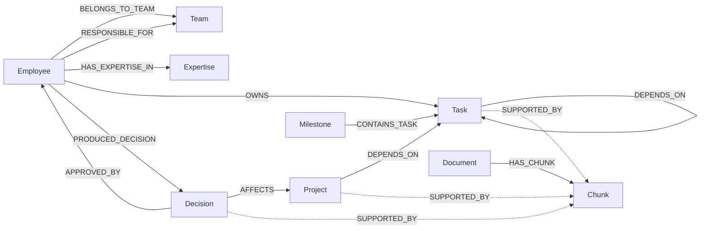
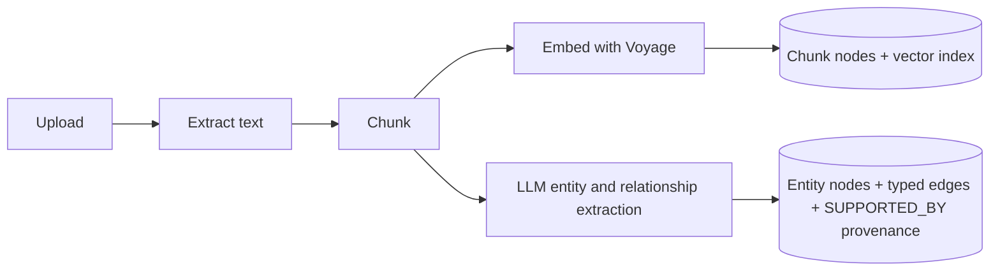
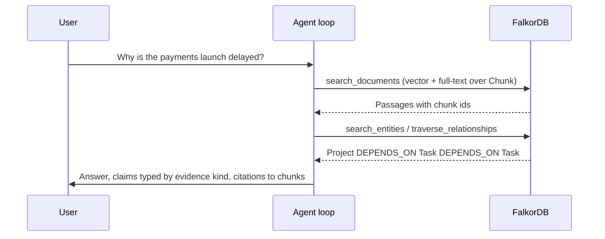

# Cerevia-backend

Intelligence layer for Cerevia: knowledge graph, hybrid retrieval, and a
controlled, citation-grounded assistant. **Express + TypeScript + FalkorDB**, with
PostgreSQL for identity/workflow, Redis/BullMQ for the ingestion queue, and a
pluggable LLM provider (Gemini by default, Anthropic optional) plus Voyage AI
embeddings.

## How the graph works

FalkorDB is the core of Cerevia.
It holds the organization's knowledge graph, the document chunks, their vector embeddings and the full-text index, so every answer the assistant gives is assembled from graph queries.
PostgreSQL only stores identity, permissions, workflow and the audit trail.

Each organization gets its own graph (`org_<orgId>`), and every node and edge also carries `orgId`, so queries are tenant-scoped twice.

### Nodes and relationships



Entity types: `Employee`, `Team`, `Department`, `Project`, `Milestone`, `Task`, `Issue`, `Decision`, `Meeting`, `Customer`, `Ticket`, `Policy`, `System`, `ActionItem`, `Expertise`.
Content types: `Document` and `Chunk`, where each chunk stores its text and a `vecf32` embedding.

Dashed edges are provenance.
When ingestion extracts an entity from a document, it links the entity to the chunk containing the supporting passage (`SUPPORTED_BY`), so every fact in the graph can be traced back to the exact text it came from.
The schema also defines `BLOCKS`, `MENTIONS`, `RELATES_TO`, `SUPERSEDES`, `COMMITTED_TO` and `DESCRIBES` for extracted relationships.

### How a document becomes graph knowledge



### How the agent queries the graph

The assistant is a bounded tool-calling loop.
The model cannot read data directly: every piece of evidence it sees comes from one of these tools, and every tool is a FalkorDB query.

| Agent tool | What it asks FalkorDB |
| --- | --- |
| `search_documents` | Hybrid retrieval over `Chunk`: `CALL db.idx.vector.queryNodes('Chunk', 'embedding', k, vecf32(q))` merged with `CALL db.idx.fulltext.queryNodes('Chunk', q)` |
| `search_entities` | `MATCH (n) WHERE n.orgId = $orgId AND toLower(n.label) CONTAINS toLower($q)` |
| `get_entity_details` | `MATCH (n {orgId: $orgId, id: $id}) RETURN n` with its provenance |
| `traverse_relationships` | `MATCH (n {id: $id})-[r]-(m) RETURN n, m, r`, the entity's neighbourhood |
| `get_project_status` | The project node with its owners, milestones, tasks and documents |
| `search_decisions` | `Decision` nodes with owner (`PRODUCED_DECISION`), approver (`APPROVED_BY`) and affected work (`AFFECTS`) |
| `find_expertise` | `MATCH (e:Employee)-[:HAS_EXPERTISE_IN]->(x) WHERE x.label CONTAINS $topic` |



### Why the graph is the source of truth

- **Citations are verified against the graph.** Citations to chunks that `search_documents` did not return in the same turn are removed, and a `confirmed` claim left without one is downgraded to `inferred`, so the model cannot cite a passage it never retrieved.
- **Multi-hop answers come from traversal.** For the question above, the delay is the chain `Payments Launch -DEPENDS_ON-> Integrate payment gateway -DEPENDS_ON-> Vendor sign-off`, which is a graph path. Keyword search alone would not find it.
- **Screens read the graph too.** The overview, the graph explorer, project dependencies, decisions, people and expertise all query FalkorDB directly, and the frontend renders the same neighbourhoods the agent traverses.

This is a pnpm-workspace monorepo:

```
apps/
  api/                 # Express API (source of the backend)
packages/
  contracts/           # OpenAPI 3.1 contract, fixtures, mock server
docs/
  adr/                 # Architecture decision records
```

## Prerequisites

- Node.js 20+ (developed on 22)
- pnpm 10.20.0 (Corepack or `corepack enable`)
- Docker + Docker Compose

## Getting started

1. Install dependencies:

   ```sh
   pnpm install
   ```

2. Start the services (FalkorDB, PostgreSQL, Redis):

   ```sh
   docker compose up -d
   ```

3. Copy `.env.example` to `.env` and fill in the API keys you want to use
   (`FALKORDB_PASSWORD` is optional — leave it empty for passwordless local dev):

   ```sh
   cp .env.example .env
   ```

4. Run the API:

   ```sh
   pnpm dev          # tsx watch, http://localhost:3001
   ```

## LLM provider

The assistant and entity/relation extraction run through a provider abstraction,
selected by `LLM_PROVIDER`:

| Provider | `LLM_PROVIDER` | Env vars |
| --- | --- | --- |
| Gemini (default) | `gemini` | `GEMINI_API_KEY`, `GEMINI_MODEL` (`gemini-flash-latest`) |
| Anthropic | `anthropic` | `ANTHROPIC_API_KEY`, `ANTHROPIC_MODEL` (`claude-opus-5-5`) |

Embeddings are separate and always use Voyage AI (`VOYAGE_API_KEY`,
`VOYAGE_MODEL`, `VOYAGE_EMBEDDING_DIMENSION`). Without a configured provider or
embedding key, ingestion and answers degrade gracefully (keyword-only search, no
extraction).

## Scripts

| Script                  | Description                                   |
| ----------------------- | --------------------------------------------- |
| `pnpm dev`              | Run the API with hot reload                   |
| `pnpm build`            | Compile all packages (tsc)                    |
| `pnpm typecheck`        | Type-check all packages                       |
| `pnpm --filter api test`| Run the test suite (vitest)                   |
| `pnpm --filter api migrate` | Apply SQL migrations + seed roles        |
| `pnpm --filter api bootstrap` | Seed default org + admin user           |
| `pnpm --filter api eval` | Run the agent evaluation harness             |
| `pnpm contracts:generate` | Generate TS types from `openapi.yaml`       |
| `pnpm contracts:mock`   | Serve the contract with Prism (port 4010)     |
| `pnpm contracts:lint`   | Lint the contract with Spectral               |

## The contract

`packages/contracts/openapi.yaml` is the source of truth, versioned under
`/api/v1`. Both the backend and any frontend generate types from it. A Prism
mock server serves the contract plus `packages/contracts/fixtures/*.json` so a
frontend can be built with zero backend dependency:

```sh
pnpm contracts:generate   # -> packages/contracts/src/types.d.ts
pnpm contracts:mock       # mock API on http://localhost:4010
```

## Services (Docker Compose)

| Service  | Host port                    | Purpose                              |
| -------- | ---------------------------- | ------------------------------------ |
| falkordb | `6379` (graph), `3100` (UI)  | Graph + vector + full-text (one graph per org) |
| postgres | `5433`                       | Identity, RBAC, workflow, audit      |
| redis    | `6380`                       | BullMQ queue (separate from FalkorDB)|

Object storage uses a **filesystem backend** in dev (`.data/uploads`); set
`STORAGE_BACKEND=s3` and the `S3_*` variables to use an S3-compatible store.

## Environment variables

See `.env.example` for the full list. Core variables: `PORT`, `LLM_PROVIDER`,
`GEMINI_*` / `ANTHROPIC_*`, `VOYAGE_*`, `FALKORDB_*`, `POSTGRES_*` (or
`DATABASE_URL`), `REDIS_*` (or `REDIS_URL`), `S3_*`, `STORAGE_BACKEND`,
`FRONTEND_ORIGIN`, `AUTO_MIGRATE`, `BOOTSTRAP_*`.
